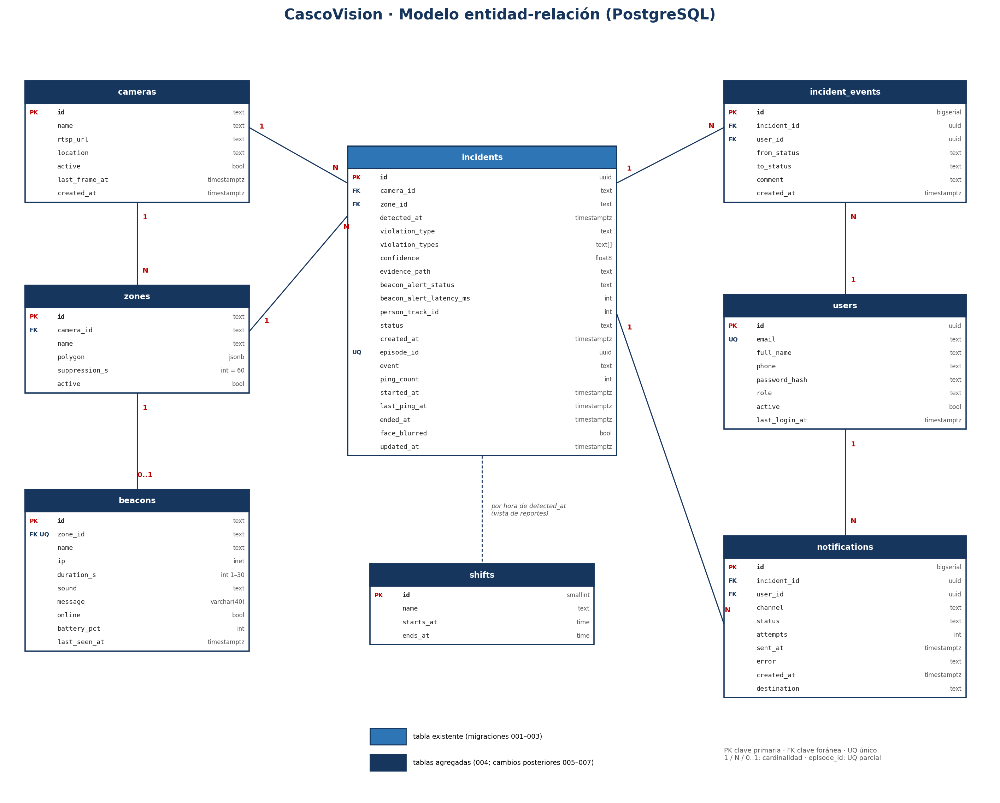

# Modelo de datos: diagrama ER y diccionario de datos

## 1. Criterios del modelo

- **PostgreSQL** como única base de datos (AD-10 del capítulo de arquitectura).
- Se conserva la tabla `incidents` desde 001 y su compatibilidad con la API; 002–003 agregan seguimiento y ciclo de episodios, 004–005 el modelo relacional y sus FK, y 006–007 controles y reportería.
- Las cámaras, zonas y balizas usan **identificadores de texto legibles** (`camara-02`, `zona-norte`, `baliza-02`), los mismos que el agente Edge ya envía en `camera_id` y `zone_id`. Así la migración 005 puede agregar las claves foráneas sin cambiar la API.
- **No se guardan datos personales de los trabajadores** (Ley N° 19.628): `person_track_id` es un número anónimo de ByteTrack y la evidencia es solo una ruta a una imagen difuminada.
- Los secretos (contraseñas de cámaras, tokens) **no van en la base de datos**: `rtsp_url` se guarda sin credenciales y estas viven en variables de entorno.

## 2. Diagrama entidad-relación

| Relación | Cardinalidad | Regla |
| --- | --- | --- |
| `cameras` → `zones` | 1 a N | Una cámara puede tener varias zonas de riesgo (RF-04) |
| `zones` → `beacons` | 1 a 0..1 | Cada zona tiene a lo más una baliza (`beacons.zone_id` único) |
| `zones` → `incidents` | 1 a N | FK compuesta 006 asegura que zona y cámara coincidan |
| `cameras` → `incidents` | 1 a N | Cada incidente ocurre en una cámara |
| `zones` → `incidents` | 1 a N | Cada incidente ocurre dentro de una zona |
| `incidents` → `incident_events` | 1 a N | Historial de cambios de estado con comentario (RF-14) |
| `users` → `incident_events` | 1 a N | Quién cambió el estado |
| `incidents` → `notifications` | 1 a N | Un SMS y un correo por destinatario (RF-11, RF-12) |
| `users` → `notifications` | 1 a N | Destinatario de la notificación |
| `shifts` ↔ `incidents` | Lógica | El turno se calcula con la hora de `detected_at` en la vista de reportes (RF-15) |

## 3. Diccionario de datos

### `cameras`

| Columna | Tipo | Nulo | Restricción o valor por defecto | Descripción |
| --- | --- | --- | --- | --- |
| `id` | `text` | No | PK, no vacío | Identificador legible, por ejemplo `camara-02` |
| `name` | `text` | No | | Nombre visible en el dashboard |
| `rtsp_url` | `text` | No | Sin usuario ni contraseña | Dirección del flujo de video |
| `location` | `text` | Sí | | Ubicación física en la faena |
| `active` | `boolean` | No | `true` | Si el agente debe analizarla |
| `last_frame_at` | `timestamptz` | Sí | | Último cuadro recibido (RF-18) |
| `created_at` | `timestamptz` | No | `now()` | Fecha de registro |

### `zones`

| Columna | Tipo | Nulo | Restricción o valor por defecto | Descripción |
| --- | --- | --- | --- | --- |
| `id` | `text` | No | PK | Identificador legible, por ejemplo `zona-norte` |
| `camera_id` | `text` | No | FK → `cameras.id`, `ON DELETE CASCADE` | Cámara sobre la que se dibuja |
| `name` | `text` | No | | Nombre visible y texto de la baliza |
| `polygon` | `jsonb` | No | Lista de 3 o más puntos `[x, y]` entre 0 y 1 | Polígono en coordenadas relativas a la imagen |
| `suppression_s` | `integer` | No | `60`, entre 10 y 600 | Ventana de supresión de alertas repetidas (RF-08) |
| `active` | `boolean` | No | `true` | Si la zona genera alertas |

### `beacons`

| Columna | Tipo | Nulo | Restricción o valor por defecto | Descripción |
| --- | --- | --- | --- | --- |
| `id` | `text` | No | PK | Identificador, igual al configurado en el firmware |
| `zone_id` | `text` | Sí | FK → `zones.id`, único, `ON DELETE SET NULL` | Zona asignada |
| `name` | `text` | No | | Nombre visible |
| `ip` | `inet` | No | Único | Dirección IP fija en la red de dispositivos |
| `duration_s` | `integer` | No | `10`, entre 1 y 30 | Duración de la alerta (RF-10) |
| `sound` | `text` | No | `siren`, `voice` o `beep` | Tipo de sonido (RF-10) |
| `message` | `varchar(40)` | Sí | | Texto en pantalla; si es nulo se usa el texto por defecto |
| `online` | `boolean` | No | `false` | Estado según el *heartbeat* (RF-09, RNF-14) |
| `battery_pct` | `integer` | Sí | Entre 0 y 100 | Última batería informada |
| `last_seen_at` | `timestamptz` | Sí | | Última respuesta de `/health` |

### `incidents` (existente)

| Columna | Tipo | Nulo | Restricción o valor por defecto | Descripción |
| --- | --- | --- | --- | --- |
| `id` | `uuid` | No | PK | Generado por la API |
| `camera_id` | `text` | No | FK → `cameras.id` (nueva en la 005) | Cámara de origen |
| `zone_id` | `text` | No | FK → `zones.id` (nueva en la 005) | Zona de la infracción |
| `detected_at` | `timestamptz` | No | Índice descendente | Momento de la detección |
| `violation_type` | `text` | No | `missing_helmet` o `missing_reflective_vest` | Infracción principal |
| `violation_types` | `text[]` | Sí | Subconjunto de los dos valores | Todas las infracciones de la persona |
| `confidence` | `double precision` | No | Entre 0 y 1 | Confianza del modelo |
| `evidence_path` | `text` | No | Relativa, sin `..`, `\` ni `:` | Ruta a la imagen procesada en el volumen de evidencia |
| `face_blurred` | `boolean` | No | `false` | La aplicación lo marca verdadero solo tras guardar el archivo difuminado (006); no certifica visualmente el resultado |
| `beacon_alert_status` | `text` | No | `alerted`, `failed` o `skipped_offline` | Resultado de la alerta física |
| `beacon_alert_latency_ms` | `integer` | Sí | ≥ 0 | Tiempo de respuesta de la baliza |
| `person_track_id` | `integer` | Sí | ≥ 0 | Número anónimo de seguimiento |
| `status` | `text` | No | `open`, `reviewed`, `closed` o `false_positive`; por defecto `open` | Estado de gestión (RF-14) |
| `created_at` | `timestamptz` | No | | Momento del registro en la API |
| `episode_id` | `uuid` | Sí | Único parcial (003) | Identificador de episodio informado por Edge |
| `event` | `text` | No | `inicio`, `ping`, `fin` (003) | Evento del ciclo de vida |
| `ping_count` | `integer` | No | `0`, >= 0 (003) | Pings recibidos |
| `started_at`, `last_ping_at`, `ended_at` | `timestamptz` | Sí | Coherencia temporal (003, 006) | Inicio, último ping y fin del episodio |
| `updated_at` | `timestamptz` | No | `now()`, se actualiza por trigger (006) | Última modificación del incidente |

### `incident_events`

| Columna | Tipo | Nulo | Restricción o valor por defecto | Descripción |
| --- | --- | --- | --- | --- |
| `id` | `bigserial` | No | PK | |
| `incident_id` | `uuid` | No | FK → `incidents.id`, `ON DELETE CASCADE` | Incidente |
| `user_id` | `uuid` | No | FK → `users.id` | Usuario que hizo el cambio |
| `from_status`, `to_status` | `text` | No | Mismos valores que `incidents.status` | Cambio de estado |
| `comment` | `text` | Sí | Obligatorio al pasar a `closed` o `false_positive` (006) | Justificación |
| `created_at` | `timestamptz` | No | `now()` | Momento del cambio |

Migración 006 también exige `from_status <> to_status`. La FK a incidentes
conserva `ON DELETE CASCADE`; este historial no es inmutable frente al dueño
de las tablas.

### `users`

| Columna | Tipo | Nulo | Restricción o valor por defecto | Descripción |
| --- | --- | --- | --- | --- |
| `id` | `uuid` | No | PK | |
| `email` | `text` | No | Único, en minúsculas | Usuario para iniciar sesión |
| `full_name` | `text` | No | | Nombre visible |
| `phone` | `text` | Sí | Formato E.164 (`+569…`) | Número para el SMS |
| `password_hash` | `text` | No | bcrypt (RNF-06) | Nunca la contraseña en claro |
| `role` | `text` | No | `admin`, `prevencionista` o `supervisor` | Rol (RF-16) |
| `active` | `boolean` | No | `true` | Usuario habilitado |
| `last_login_at` | `timestamptz` | Sí | | Último inicio de sesión |

### `notifications`

| Columna | Tipo | Nulo | Restricción o valor por defecto | Descripción |
| --- | --- | --- | --- | --- |
| `id` | `bigserial` | No | PK | |
| `incident_id` | `uuid` | No | FK → `incidents.id`, `ON DELETE CASCADE` | Incidente notificado |
| `user_id` | `uuid` | No | FK → `users.id` | Destinatario |
| `channel` | `text` | No | `sms` o `email` | Canal |
| `status` | `text` | No | `pending`, `sent` o `failed`; por defecto `pending` | Estado del envío |
| `attempts` | `integer` | No | `0` | Intentos realizados |
| `sent_at` | `timestamptz` | Sí | | Momento del envío exitoso (RNF-03) |
| `error` | `text` | Sí | | Último error del proveedor |
| `created_at` | `timestamptz` | No | `now()` (006) | Momento de creación para medir latencia |
| `destination` | `text` | No | Destino efectivamente usado (006) | Teléfono o correo como snapshot del envío |

Índice único (006): `(incident_id, user_id, channel)`.

### `shifts`

| Columna | Tipo | Nulo | Restricción o valor por defecto | Descripción |
| --- | --- | --- | --- | --- |
| `id` | `smallint` | No | PK | |
| `name` | `text` | No | Único | `Mañana`, `Tarde` o `Noche` |
| `starts_at`, `ends_at` | `time` | No | | Horario; el turno de noche cruza la medianoche |

## 4. Índices propuestos

| Tabla | Índice | Uso |
| --- | --- | --- |
| `incidents` | `detected_at DESC` (ya existe) | Historial ordenado (RF-13) |
| `incidents` | `(zone_id, detected_at DESC)` | Filtro por zona y reportes por zona |
| `incidents` | `(status) WHERE status = 'open'` | Incidentes activos del dashboard |
| `incident_events` | `(incident_id, created_at)` | Historial de un incidente |
| `notifications` | `(status) WHERE status = 'pending'` | Reintentos del notificador |

## 5. Plan de migración

Secuencia aprobada en **D2 v1.0**:

1. **003 — ciclo de vida de episodios**: amplía `incidents` para incorporar el ciclo de vida de episodios, conservando la compatibilidad con la API.
2. **004_modelo_completo.sql** (tarea 4.8): crea `cameras`, `zones`, `beacons`, `users`, `incident_events`, `notifications` y `shifts`.
3. **005_claves_incidentes.sql**: agrega a `incidents` las claves foráneas hacia `cameras` y `zones` y los índices de §4. Va separada porque exige que existan las cámaras y zonas de los incidentes ya registrados (datos semilla de la tarea 4.9).
4. **006_integridad_y_auditoria.sql:** coherencia cámara-zona, notificaciones,
   eventos, evidencia difuminada y marcas temporales.
5. **007_vistas_reporteria.sql** (tarea 4.11): vistas por zona, turno y hora;
   convierte `detected_at` a la hora local `America/Santiago`, incluido Noche.

La tabla `schema_migrations` registra archivo, SHA-256 y fecha mediante
`db/apply_migrations.py`. Las migraciones aplicadas no se editan; se usa una
migración compensatoria para revertir cambios que requieran conservar datos.

## 6. Puntos a confirmar

- **Retención:** recomendar 90 días para imágenes y retención más larga para metadatos, sujeto a aprobación de negocio y normativa. No se automatiza el borrado; primero definir respaldo y proceso de limpieza.
- **Balizas por zona:** mantener máximo una (0..1) para el alcance de demo; cambiar solo si operaciones confirma varias balizas por zona.
- **Zonas del supervisor:** recomendar asignación explícita por frente antes de habilitar acceso; `user_zones` queda pendiente hasta tener esa matriz validada. No asumir acceso global.
- **RNF-09:** `face_blurred` registra que el proceso informó éxito. Para probar 100 % se debe revisar y corregir el inventario histórico de imágenes; la columna sola no verifica píxeles.
- **Roles:** ver `db/roles.sql`. Los roles de login PostgreSQL son cuentas técnicas/de conexión y no se sincronizan automáticamente con `users.role` ni con menús de FastAPI.
