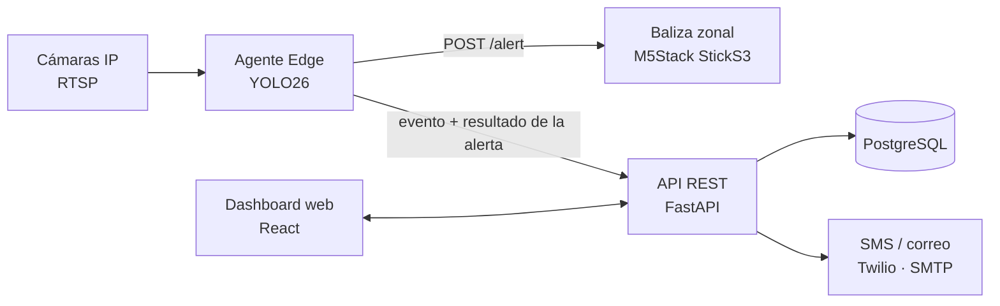

# CascoVision

**Sistema de detección automatizada de EPP mediante visión computacional**
Proyecto APT · Capstone PTY4614 · Duoc UC · 2026.02 · Equipo 1 (sección 802D)

> **Estado (S13):** MVP ejecutable de punta a punta con Docker Compose: cámara RTSP → agente Edge con YOLO26 → baliza zonal (simulada) → API REST con PostgreSQL → dashboard web con login y roles. Pendiente: firmware de la baliza real, SMS y correo, y reportes en PDF y Excel.

---

## Descripción

**Qué hace.** CascoVision usa las **cámaras IP que la faena ya tiene instaladas** para detectar automáticamente a las personas que no llevan **casco de seguridad o chaleco reflectante** dentro de una zona de riesgo. Ante cada infracción:

1. registra el incidente con evidencia fotográfica (rostros difuminados);
2. activa una **baliza zonal** que emite una alerta sonora y visual en el mismo sector;
3. notifica al prevencionista de riesgos por SMS y correo;
4. muestra el incidente en un dashboard web con historial y reportes.

**A quién va dirigido.** A empresas constructoras, en particular a los **prevencionistas de riesgos** y jefes de terreno.

**Qué problema resuelve.** La construcción tiene una de las tasas de accidentabilidad más altas de Chile, y no usar el EPP es una causa evitable. Un prevencionista no puede vigilar todos los frentes de la faena a la vez, y cada infracción arriesga multas de **1 a 150 UTM**. CascoVision convierte la supervisión de **reactiva** a **preventiva y en tiempo real**, y lo hace **sin identificar a los trabajadores**: detecta objetos, no personas, y todo el procesamiento es local.

## Tecnologías

| Capa | Tecnología |
| --- | --- |
| Visión computacional | Python · YOLO26 (Ultralytics) · OpenCV · YuNet (difuminado de rostros) |
| Captura de video | Cámaras IP · RTSP / ONVIF |
| Backend | FastAPI (Python) |
| Base de datos | PostgreSQL |
| Frontend | React.js |
| Alerta física | M5Stack StickS3 (ESP32-S3) · HTTP en la red local |
| Notificaciones | Twilio (SMS) · SMTP (correo) |
| Despliegue | Docker · Docker Compose (on-premise, sin nube) |

## Arquitectura



- El **agente Edge** analiza 1 cuadro por segundo por cámara y verifica si la persona sin EPP está dentro de una zona de riesgo. Si lo está, **activa directamente la baliza de la zona** (`POST /alert` con token) y luego envía el evento a la API.
- La **API** registra el incidente y el resultado de la alerta física, y notifica al prevencionista. La orden a la baliza no pasa por la API: así la alerta es más rápida y funciona aunque la API esté caída.
- Todo el software corre en contenedores Docker dentro de la red de la faena: **el video no sale de la obra**.
- Latencia objetivo desde la detección hasta la alerta en la baliza: **menos de 5 segundos**.

## Ejecución con Docker (recomendada)

Requisito: [Docker](https://www.docker.com/) con Compose v2 (Docker Desktop en Windows y macOS). No hace falta instalar Python, Node ni PostgreSQL.

```bash
git clone https://github.com/lonelystar16/AV_AldoMartinez802D_Equipo1.git
cd "AV_AldoMartinez802D_Equipo1/Fase 2/Evidencias Proyecto"
cp .env.example .env        # PowerShell: Copy-Item .env.example .env
# editar .env: reemplazar cada "cambiar_esto" por un valor al azar
#   (JWT_SECRET y BALIZA_TOKEN de 32+ caracteres; CASCOVISION_ADMIN_PASSWORD de 12+)
# perfil dev: copiar un video público a docker/rtsp-sim/video_prueba.mp4
docker compose --profile dev up -d --build
docker compose ps
```

| Servicio | URL en el equipo | Para qué |
| --- | --- | --- |
| Dashboard | http://127.0.0.1:8080 | Entrar con `CASCOVISION_ADMIN_EMAIL` y `CASCOVISION_ADMIN_PASSWORD` |
| API | http://127.0.0.1:8000/docs | Documentación interactiva de la API |
| Baliza simulada | http://127.0.0.1:8081/health | `"alerting": true` mientras suena |

El perfil `dev` agrega una cámara RTSP que repite el video y una baliza simulada, así que todo el flujo corre en un solo PC. Sin `--profile dev` se levantan `db`, `api`, `dashboard` y `edge` para una faena real (cámara en `CAMARA_FUENTE` y baliza en `docker/edge/config.json`). Detalle, volúmenes y respaldo: [`docs/DESPLIEGUE_DOCKER.md`](Fase%202/Evidencias%20Proyecto/docs/DESPLIEGUE_DOCKER.md).

## Ejecución sin Docker (desarrollo)

Requisitos: Python **3.12** con [uv](https://docs.astral.sh/uv/) y, para el dashboard, Node 22. Desde la raíz del repositorio:

```bash
uv sync --group dev
# PowerShell: $env:VAR="valor"
export EDGE_API_TOKEN=un_valor_secreto JWT_SECRET=un_secreto_de_32_caracteres_o_mas
export CASCOVISION_ADMIN_EMAIL=admin@cascovision.local CASCOVISION_ADMIN_PASSWORD=una_clave_larga
uv run uvicorn app.main:app --app-dir "Fase 2/Evidencias Proyecto/src/api" --reload
```

Sin `CASCOVISION_STORAGE=postgres` la API guarda en un archivo JSON y solo entra el administrador del entorno. El dashboard en modo desarrollo (`http://127.0.0.1:5173`) se levanta con `npm install` y `npm run dev` en `Fase 2/Evidencias Proyecto/src/dashboard`. Rutas, roles y variables: [`docs/API.md`](Fase%202/Evidencias%20Proyecto/docs/API.md).

## Pruebas

```bash
uv sync --group dev --group yolo
uv run pytest
```

Las pruebas de PostgreSQL se saltan salvo que se defina `CASCOVISION_TEST_POSTGRES=1` con las variables `POSTGRES_*` de una base de pruebas; cada caso crea y borra su propio esquema.

### Dependencias del modelo YOLO26

El agente Edge y los scripts de visión usan además las librerías del grupo
`yolo`, documentadas en detalle en
[`Yolo/README.md`](Fase%202/Evidencias%20Proyecto/Yolo/README.md). El proyecto
usa **uv** como fuente única de dependencias:

```bash
uv sync --group dev --group yolo
```

El grupo `yolo` instala PyTorch con CUDA 12.6 desde el índice oficial de
PyTorch (`torch==2.14.1+cu126`), Ultralytics, `lap` para el seguimiento
ByteTrack y `opencv-python` en la rama 4.x. La versión de OpenCV está fijada
por debajo de 5.0 porque la 5.x eliminó `cv2.CascadeClassifier`, que usan los
scripts de prueba. En un equipo sin GPU NVIDIA, hay que quitar el índice de
PyTorch y dejar que se instale la variante de CPU.

Con la cámara conectada:

```bash
# Monitoreo local, sin API
uv run python "Yolo/modelamiento/monitoreo_v2.py"

# Agente Edge: reporta los incidentes a la API
uv run python "Yolo/modelamiento/monitoreo_api.py"
```

## Modelo de detección

El modelo entregado es [`Fase 2/Evidencias Proyecto/models/cascovision_yolo26s.pt`](Fase%202/Evidencias%20Proyecto/models/) (YOLO26s, 19,4 MB), con sus métricas en el README de esa carpeta. El criterio de aceptación es mAP@0,5 ≥ 0,90 y *recall* ≥ 0,85 (RNF-05 del SRS). `models/` es la única excepción a la regla de `.gitignore` que excluye `*.pt` y `*.onnx`. El dataset de entrenamiento (~440 MB) no se versiona; el README del modelo explica cómo obtenerlo.

El detector actual (`train-10`) trabaja con **5 clases** (`helmet`, `no_helmet`, `no_vest`, `Person`, `vest`) sobre un export de Roboflow del conjunto Construction-PPE. La diferencia con el modelo anterior no es solo de esquema: **las infracciones se detectan de forma positiva**, en vez de inferirse por la ausencia de un casco. Eso se traduce en un salto del *recall* de las reglas de negocio:

| Regla | `train-9` (11 clases) | **`train-10` (5 clases)** |
| --- | --- | --- |
| ¿lleva casco? | P 1,000 · R 0,643 · E 0,643 | **P 0,986 · R 0,947 · E 0,934** |
| ¿lleva chaleco? | P 0,951 · R 0,583 · E 0,566 | **P 1,000 · R 0,887 · E 0,887** |

Con esto **el RNF-05 se cumple en las dos reglas de negocio** (recall ≥ 0,85); ninguna lo cumplía antes. El mAP@0,5 promedio queda en 0,877, por debajo del 0,90 del RNF-05, pero esa cifra no es comparable con la del modelo anterior: el dataset nuevo tiene 5 clases todas del producto, frente a las 11 del anterior (6 irrelevantes que hundían el promedio). El proceso de modelado, el análisis de desempeño y las líneas de trabajo pendientes están en [`Yolo/README.md`](Fase%202/Evidencias%20Proyecto/Yolo/README.md).

La línea base `train-9` (11 clases) queda documentada como referencia histórica: mAP@0,5 = 0,624, con señales de sobreajuste entre entrenamiento y validación.

La misma carpeta incluye `face_detection_yunet_2023mar.onnx` (227 KB), el detector de rostros que usa el agente Edge para difuminar la evidencia.

## Equipo

| Integrante | Rol | Responsabilidades |
| --- | --- | --- |
| Iahn Vera | Jefe de proyecto / IA | Gestión, modelo YOLO26, agente Edge (`dev-iahn`) |
| Joaquín Armijo | Desarrollo fullstack | API REST, dashboard, alertas remotas, Docker, manual técnico D4 (`dev-joaco`) |
| Fernando Muñoz | Base de datos e IoT | PostgreSQL, receptor simulado y firmware de la baliza (`dev-fernando`) |
| Benjamín Cáceres | QA | Pruebas, integración continua, revisión de PRs, informe de pruebas D3 (`qa`) |

Flujo de ramas: `dev-*` → pull request → `qa` → pull request → `main` (protegida).

## Metodología

**Tradicional en cascada.** El proyecto avanza por fases secuenciales, y cada una cierra con un entregable aprobado (puerta de fase):

| Fase | Semanas | Entregable |
| --- | --- | --- |
| Inicio y planificación | 1–4 | Definición del proyecto y carta Gantt |
| Análisis de requerimientos | 5–7 | D1 · Documento de requerimientos (SRS) |
| Diseño | 8–9 | D2 · Documento de diseño y plan de pruebas |
| Construcción | 9–13 | Componentes con pruebas unitarias y Docker |
| Integración y pruebas | 13–15 | D3 · Plan de pruebas y evidencias |
| Implantación y cierre | 14–15 | D4 · Manual técnico e informe final |
| Presentación | 16–18 | Defensa |

Las fases se solapan de forma controlada en las semanas 9, 13 y 14–15: una tarea solo empieza antes si no depende del entregable pendiente (por ejemplo, el dataset no depende del documento de diseño). La carta Gantt detallada está en [`Fase 2/Evidencias Grupales/`](Fase%202/Evidencias%20Grupales/).

## Estructura del repositorio

```
├── Fase 1/                         Evidencias de la definición del proyecto
├── Fase 2/
│   ├── Evidencias Grupales/        D1 SRS · carta Gantt · D2 Diseño · D3 Pruebas · D4 Manual técnico
│   ├── Evidencias Individuales/    Diarios y autoevaluaciones de cada integrante
│   └── Evidencias Proyecto/        Código y artefactos técnicos
│       ├── .env.example            Variables de entorno de ejemplo
│       ├── src/
│       │   ├── api/                API REST (FastAPI)
│       │   ├── edge/               Agente Edge (visión computacional)
│       │   ├── dashboard/          Dashboard web (React)
│       │   └── firmware/           Firmware de la baliza zonal
│       ├── Yolo/                   Entrenamiento, motor de detección y agente Edge (provisional)
│       ├── models/                 Modelo YOLO26 entrenado, detector de rostros YuNet y métricas
│       ├── db/migrations/          Esquema SQL de PostgreSQL
│       ├── tests/                  Pruebas automatizadas
│       └── docs/diagramas/         Diagramas UML y de arquitectura
└── Fase 3/                         Presentación final
```
